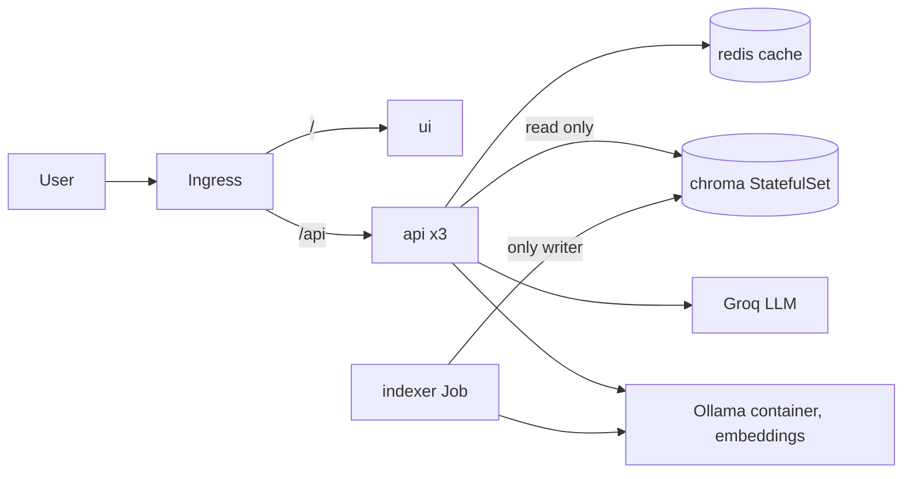

# RAHBAR

[](https://github.com/CapsuleFlyer/rahbar/actions/workflows/ci.yml)

Team: CapsuleFlyer and AbubakrQ.

RAHBAR answers questions only from a real document corpus (the D&D 5th-edition rules), cites its sources and says
"the corpus does not cover this" when it cannot answer. It runs on Kubernetes: an indexer Job writes the vector
store, an api reads it, and a semantic cache sits in Redis.

Corpus: the D&D 5th-edition rules, all public. The two System Reference Documents (SRD 5.1, 2014 and
SRD 5.2.1, 2024) are CC-BY-4.0 and committed in `corpus/raw/`; the other four (Sage Advice Compendium and three
errata PDFs) are **not** committed: `corpus/sources.yaml` + `corpus/MANIFEST.md` (URLs and SHA-256) +
`corpus/fetch.py` recreate them. See `docs/CORPUS.md`. Answers are generated by Groq's free hosted API; embeddings come from a small Ollama model (`nomic-embed-text`) on your machine (ADR 0004).

> This work includes material from the System Reference Document 5.1 ("SRD 5.1") and the System Reference
> Document 5.2.1 ("SRD 5.2.1") by Wizards of the Coast LLC, licensed under the Creative Commons Attribution 4.0
> International License (https://creativecommons.org/licenses/by/4.0/legalcode).



## Prerequisites (Windows 11 + WSL2, also fine on Linux/macOS)
Run everything below in an **Ubuntu (WSL2) terminal**, with the repo cloned inside the Ubuntu home folder.
1. Docker Desktop, with Settings > Resources > WSL integration switched on for your Ubuntu distro.
2. In Ubuntu: `make`, `curl`, `git`, Python 3.12, `kubectl` and `minikube` (Python 3.12 on Ubuntu 22.04 comes from the
   `ppa:deadsnakes/ppa` repository).
3. A free Groq API key from console.groq.com (no card needed).
4. `poppler-utils` for rasterizing the scanned PDF: `sudo apt install -y poppler-utils`.

Ollama (embeddings only) runs as a **container on the minikube Docker network**, not on your PC. The host-gateway
address `host.minikube.internal` could not reach an Ollama installed on Windows or in WSL (Docker Desktop's gateway is a
different network), so the NetworkPolicies and the ConfigMap point at `192.168.49.10`. Start it once, after `make cluster`:
```bash
docker run -d --name ollama --network minikube --ip 192.168.49.10 \
  -v ollama-models:/root/.ollama --restart unless-stopped ollama/ollama
docker exec ollama ollama pull nomic-embed-text
```
If you ever recreate minikube, run `docker rm -f ollama` first and repeat the commands (the `ollama-models` volume keeps the model).

## From a clean clone to an answer
```bash
chmod +x scripts/*.sh scripts/ci/*.sh  # only needed if your clone lost the executable bit
make install PY=python3.12         # .venv for fetch/eval tooling
make cluster                       # minikube + Calico + metrics-server + ingress
# now start the Ollama container (command above)
make images                        # build and load the 3 images
kubectl apply -k k8s/overlays/dev  # namespace, config, chroma, redis, api, ui, ingress, indexer Job
export LLM_API_KEY=<your groq key>; make secret   # key goes to the cluster only, never to a file
kubectl -n rahbar rollout restart deployment/api  # pods read the Secret at start
make fetch                         # download the corpus
make corpus-load                   # copy it into the corpus PVC; the indexer Job starts reading it
kubectl -n rahbar wait --for=condition=complete job/indexer --timeout=15m
echo "$(minikube ip) rahbar.local" | sudo tee -a /etc/hosts
make ask Q="What DC does the Hide action need?"          # a grounded, cited answer
make ask Q="What is a mind flayer's Mind Blast?"        # not in the corpus: must decline (answered_from_context false)
```
**Check the embedding link before the indexer runs** (the output must list `nomic-embed-text`):
```bash
minikube ssh "curl -s http://192.168.49.10:11434/api/tags"
```
The same address is set in two places that must agree: `OLLAMA_URL` in `k8s/base/configmap.yaml` and the two `ipBlock`
rules (`api-egress`, `indexer-egress`) in `k8s/base/networkpolicy.yaml`.

**Browser on Windows.** `minikube ip` is only reachable from inside WSL. To open the UI from Windows, run
`minikube tunnel` in a spare Ubuntu terminal and add `127.0.0.1 rahbar.local` to
`C:\Windows\System32\drivers\etc\hosts` (as administrator), then browse to http://rahbar.local.

Re-index with no redeploy: `kubectl create job --from=cronjob/reindex manual-reindex-1 -n rahbar`.
The Groq free tier is rate-limited per minute; if answers come back slowly or as a safe fallback, wait a minute and retry.
Secrets are never committed.

## API
| Method | Path | Purpose |
| --- | --- | --- |
| GET | /healthz | liveness, touches no dependency |
| GET | /readyz | Chroma reachable, collection non-empty, Redis reachable, embedding pin matches |
| GET | /metrics | Prometheus metrics |
| POST | /api/ask | `{"question": "..."}` returns a cited answer or an honest abstention |

See `docs/` for corpus, pipeline, failure analysis, ADRs and engineering notes.
